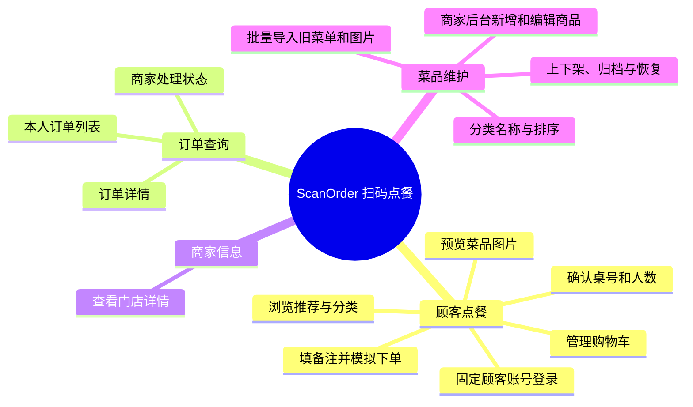

# 首次点餐流程

这是现有 H5 的用户旅程导航，行为约束以 [菜单](../../openspec/specs/menu/spec.md)、[订单](../../openspec/specs/ordering/spec.md)、[图片与导入](../../openspec/specs/food-media/spec.md) 对应的 OpenSpec 来源为准。

## 业务脑图

## 体验路线

1. 首次打开移动端时确认默认顾客账号并一键登录；已登录顾客直接进入首页。
2. 确认默认桌号并选择 1 至 5 位用餐人数，点击“开始点餐”进入菜单。
3. 浏览按后台分类顺序组织的在售推荐与菜单，预览图片，按菜品 UUID 加入购物车；同名不同 ID 菜品仍分别计数。
4. 在购物车增加、减少或清空菜品。总价使用整数分计算，应等于各单价乘数量之和。
5. 点击“选好了”进入提交页，确认人数、数量和备注。空购物车不能提交，提交中阻止重复点击。
6. 提交失败保留当前内容并显示错误；成功后清空购物车，进入本人订单列表，再查看订单详情。
7. 订单按下单时的菜名、图片和价格展示快照，商家接单、完成或取消后顾客可看到最新状态。
8. 商家从 `/admin` 登录，维护分类、商品和订单；移动端旧 `/upload` 路由不再提供，门店信息页继续展示商家资料。

购物车和人数是页面会话内存状态，刷新后重置。初始人数为 1。固定顾客账号可跨设备查看同一账号的新订单；无归属旧订单只在商家后台显示。二维码管理、真实支付、退款和员工账号仍不在当前产品能力中。

依据：`apps/web/src/App.tsx`、`apps/web/src/pages/customer/Entry.tsx`、`apps/web/src/pages/customer/SubmitOrder.tsx`、`tests/e2e/ordering.spec.ts`。
